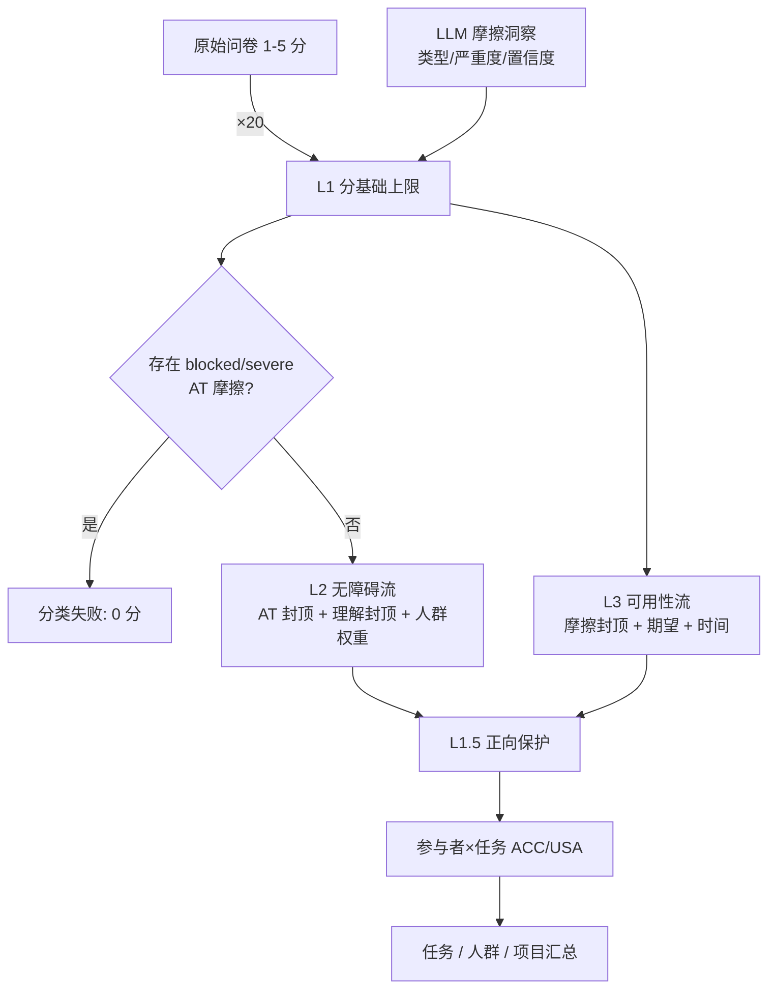
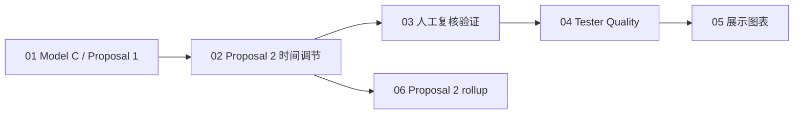

# CS19 Capstone — 无障碍与可用性多模态评分

<p align="center">
  
  
  
  
  
</p>

CS19 Capstone 项目的**最终交付包**。围绕 AAMI 保险网站的真实用户测试数据，项目把四类证据——**问卷自评、自述反馈、LLM 提取的摩擦洞察、转录片段/任务耗时**——融合成两个可解释的评分（无障碍 ACC / 可用性 USA），并额外给出一个独立的**测试者质量评分（Tester Quality, TQ）**，用于判断反馈证据本身是否充分。

核心实现是基于 Jupyter Notebook 的 **Model C/C3** 原型，包含 **Proposal 1**（评分规则优化）、**Proposal 2**（参与者归一化时间调节）、**人工复核验证**与 **TQ 评分**，并附带数据字典、结果文件、展示材料和交接文档。

> **项目定位**：这是供分析、验证和交接使用的研究型 MVP，**不是**已部署的生产评分服务，也不是可直接接入客户系统的产品。所有自动化结果都应保持可解释并接受人工复核。

---

## 目录

- [1. 项目目标与三个输出](#1-项目目标与三个输出)
- [2. 研究背景与模型选择](#2-研究背景与模型选择)
- [3. 评分流程与关键约束](#3-评分流程与关键约束)
- [4. Proposal 1 评分规则详解](#4-proposal-1-评分规则详解)
- [5. Proposal 2 时间调节](#5-proposal-2-时间调节)
- [6. 人工复核验证](#6-人工复核验证)
- [7. Tester Quality 评分](#7-tester-quality-评分)
- [8. 主要结果](#8-主要结果)
- [9. 数据来源与覆盖](#9-数据来源与覆盖)
- [10. 仓库结构](#10-仓库结构)
- [11. Notebook 工作流](#11-notebook-工作流)
- [12. 输出文件清单](#12-输出文件清单)
- [13. 环境与运行方法](#13-环境与运行方法)
- [14. 数据字典与交接材料](#14-数据字典与交接材料)
- [15. 数据隐私与伦理](#15-数据隐私与伦理)
- [16. 解释结果时的限制](#16-解释结果时的限制)
- [17. 术语表](#17-术语表)
- [18. 致谢与引用](#18-致谢与引用)

---

## 1. 项目目标与三个输出

项目最终工作围绕三个目标：

1. 以 **Model C/C3** 为基础，对网站无障碍与可用性评分；
2. 用 **Proposal 1 / Proposal 2** 改进评分规则；
3. 另行估计测试反馈的**完整度与证据质量**，支持人工复核排序。

| 输出 | 含义 | 主要实现 |
| --- | --- | --- |
| **无障碍评分（ACC）** | 依据辅助技术（AT）与理解/认知（COMP）摩擦证据，下调问卷自评分数 | Notebook 01 的 L1/L2 流 |
| **可用性评分（USA）** | 依据可用性（USA）摩擦、期望达成情况与时间信号下调分数 | Notebook 01 的 L1/L3 + Notebook 02 的 L3.8 |
| **测试者质量（TQ）** | 评估反馈深度、任务覆盖、证据一致性、参与证据是否充分 | Notebook 04，独立于 ACC/USA |

评分以问卷中的任务自评为**起点**（1–5 分 ×20 → 0–100 上限），再按参与者、任务与证据匹配情况应用规则；分数**只能持平或下降**，不会因规则被抬高（L1.5 的正向保护是唯一的"保底"例外，且不改变上限逻辑）。

## 2. 研究背景与模型选择

毕业设计报告把问题概括为：**问卷自评代表参与者本人对体验的判断，应当被保留；但单独依赖自评，可能看不到任务中的阻断、反复操作、困惑或异常耗时。** 项目尝试把问卷与测试中可观察到的证据结合起来，让分数调整更可解释、可检查，同时避免自动化判断取代参与者声音或专家判断。

项目比较了四类评分思路：

| 模型 | 核心做法 | 在项目中的作用与边界 |
| --- | --- | --- |
| **Model A：问卷平均** | 直接汇总参与者自评 | 基准；简单透明，但正向自评可能掩盖已确认的严重障碍 |
| **Model B：分析师辅助** | 问卷基准 + 分析师/专家对严重情况修正 | 人工流程参照；结构化与复现能力有限 |
| **Model C/C3：问卷分数上限** | 从自评分出发，根据任务证据向下调整 | **被选为 MVP 基础**：保留自评锚点，规则易追踪；原始硬上限可能对中度问题过重 |
| **Model D：证据优先协调** | 由观察证据生成分数，再与自评协调 | 比较与未来设计参考；当前样本下参与者级聚合可能稀释关键任务阻断，且更难验证 |

选择 Model C 不代表它已被证明在所有数据集上最优，而是基于本项目的数据完整度、可解释性要求、阻断问题处理和交付周期，认为它更适合作为**可审计的优化起点**。完整学术论证与参考文献见毕业设计报告；本 README 侧重实现与交付。

> 基线比较使用 **67 条记录 / 17 名参与者 / 4 个任务**；后续优化与 Proposal 2 使用 **136 条 Model C 记录**。两组数字对应不同分析阶段，不宜直接当作同一口径的性能比较。

## 3. 评分流程与关键约束



**贯穿全流程的硬约束：**

1. 分数从自评出发，只能持平或下降；
2. 触发摩擦规则的置信度阈值为 **0.70**，低于阈值的证据不生效；
3. 严重 / 阻断、高严重度及部分叠加规则使用**硬上限**，不做置信度渐进化；
4. **Proposal 2 只改 L3 时间调节**，不碰 L1/L2、ACC 或 Proposal 1 规则，也不会提分；
5. TQ 是独立的第三分数，**不得**乘入或替代 ACC/USA；
6. 人工复核是**验证样本**，不是官方真值。

## 4. Proposal 1 评分规则详解

### 4.1 L1 — 基础上限与 AT 硬规则

- 问卷 1–5 分统一 `×20` 转为 0–100 上限；
- **分类失败**：存在 `accessibility` 类型、严重度为 `blocked` / `severe`、置信度 > 0.70 的摩擦 → 该参与者×任务记 **0 分**，并从均值中排除；
- **高严重度 AT 封顶**：1 条 `high` → 上限 20；≥2 条 → 上限 10。

### 4.2 L2 — 无障碍流（ACC）

L2 在 L1 结果上继续下调：

| 摩擦类型 | 规则 | 效果 |
| --- | --- | --- |
| AT 高严重度 | 1 条 → 上限 20；≥2 条 → 上限 10 | 硬上限 |
| AT 中严重度 | 基础扣分 20，下限 30（渐进） | 置信度比例扣分 |
| 理解/认知 高或严重 | 上限 40 | 按人群权重缩放 |
| 理解/认知 中度 | 基础扣分 15，下限 50；≥3 条 → 上限 40 | 按人群权重缩放 |
| 理解/认知 低度 | 上限 70；≥3 条 → 上限 60 | 按人群权重缩放 |
| 期望超出（exceeded） | 理解流最低 45 分 | 45 分下限只保护理解流，AT 仍可压到更低 |

**人群权重**（理解/认知摩擦对 ACC 的影响强度）：`ESL / DF / ND = 1.0`、`BL / LV = 0.5`、`OL = 0.6`、`General = 0.4`。

### 4.3 L3 — 可用性流（USA）

| 触发条件 | 效果 |
| --- | --- |
| 严重可用性问题，或 ≥3 条高严重度 | 上限 50 |
| 高 + 中度同时存在 | 上限 60 |
| 中 + 低度同时存在 | 基础扣分 12，下限 75（渐进） |
| ≥3 条中度 | 基础扣分 25，下限 70（渐进） |
| ≥3 条低度 | 上限 80 |
| 期望未达成 `not met` | ×0.80 |
| 期望远低于 `fell well below` | ×0.60 |
| 多条规则同时适用 | **取最严格上限** |

### 4.4 置信度比例扣分

对适用的中度摩擦，Proposal 1 使用置信度比例扣分：

```text
confidence < 0.70            → 不触发
confidence ≥ 0.70            → confidence_weight = (confidence - 0.70) / 0.30
扣分 = round(base_penalty × confidence_weight)
最终分数 = max(规则下限, 原分 - 扣分)
```

即：刚过阈值的证据只带来很小扣分，置信度越高越接近完整基础扣分。严重/阻断、高严重度及部分特定叠加规则仍保留硬上限。

### 4.5 L1.5 — 正向证据保护

在 L2 / L3 计算完成后，对满足条件的记录（自评高、达到/超出预期、且没有高严重度问题）应用正向分数下限，避免"证据少但体验好"的记录被过度惩罚。

## 5. Proposal 2 时间调节

Proposal 2 解决"不同人完成同一任务的自然速度不同"的问题，只作用于 **L3.8 时间调节**：

1. **个人速度因子**：用参与者总实际耗时 / 建议耗时估计，限制在 **0.7–1.5**；
2. **任务归一化耗时**：`任务实际耗时 ÷ 个人速度因子`，再与该任务的归一化中位耗时比较，得到 `normalized_median_ratio`；
3. **时间上限**：

| 归一化时间比 | L3 上限 |
| ---: | ---: |
| < 2× | 不调整 |
| ≥ 2× | 50 |
| ≥ 3× | 40 |
| ≥ 4× | 25 |

约束：

- 只影响 **USA 的 L3**，不改写 L1/L2、ACC 或 Proposal 1 规则；
- 不会提高分数（0 个 `score_increase_violations`）；
- 重试/困惑等文字只作为解释背景，**不作为直接扣分规则**。

在 136 条 Model C 记录中：**95 条**匹配到时间证据、**14 条**触发时间上限、**12 条** L3 分数发生变化，平均 L3 从 **62.86 → 59.09**。

## 6. 人工复核验证

Notebook 03 建立人工复核样本，对三种口径与复核者估分比较：原始问卷分、Model C（时间调节前）、Proposal 2 后。

- 样本：**18 个参与者-任务案例**，其中 **14 个**有可用于误差比较的人工估分，4 个证据不足；
- 平均绝对误差（MAE）：

| 口径 | MAE | 中位绝对误差 | 有效案例 |
| --- | ---: | ---: | ---: |
| 原始问卷分 | 13.57 | 10.0 | 14 |
| Model C（时间调节前） | **13.28** | 10.0 | 14 |
| Proposal 2（时间调节后） | 19.49 | 10.0 | 14 |

**这是一个必须诚实呈现的结果**：在当前 14 个有效案例里，Proposal 2 后的 MAE 反而更高。样本很小，不能据此断言 Proposal 2 全面更差；但也不能宣称它总是更好。时间信号有用但噪声大——有些耗时长的案例其实是"成功但操作细致/话多"，被时间上限过度惩罚。

另有 11/14 个案例出现多个候选分数与人工分同样接近（并列），说明单点误差指标本身也不稳定。

## 7. Tester Quality 评分

TQ 是独立的第三分数，用于回答"这名测试者的反馈证据是否足够支撑评分"，**不是**参与者能力分数。

| 维度 | 权重 | 含义 |
| --- | ---: | --- |
| 反馈深度 Feedback Depth | 35% | 开放题回答的信息量与具体性 |
| 任务覆盖 Task Coverage | 25% | 是否覆盖了应完成任务 |
| 证据一致性 Evidence Consistency | 25% | 问卷自评与观察证据是否一致 |
| 参与/投入证据 Engagement | 15% | 转录/时长等参与证据是否充分 |

- 缺失维度会被记录，并对可用维度**重新归一化权重**；
- 方法说明明确：不因残障、辅助技术使用、ESL 身份或完成较慢而直接降低评分；
- TQ 用于**质量监测与复核排序**，不能乘入或替代 ACC/USA。

当前结果：**21 名测试者**全部有分，平均 **90.12**；18 人 High Quality、3 人 Good Quality，0 人 Medium/Low；13/13 项质量检查通过。另有 3 人触发 `high_survey_model_conflict` 复核标记（问卷自评与模型证据冲突），17 人无需复核。

> 该分数衡量"可用证据质量"，高 TQ 不代表 ACC/USA 对每个任务都准确，也不代表参与者"表现优秀"。

## 8. 主要结果

| 指标 | 结果 | 来源文件 |
| --- | ---: | --- |
| Proposal 1 项目级 ACC | **50.72**（sd 31.47） | `outputs/proposal1_project_summary.txt` |
| Proposal 1 项目级 USA | **60.10**（sd 12.66） | 同上 |
| Proposal 2 处理行数 | 136 行 Model C 记录 | `proposal2_integration_summary.csv` |
| 匹配到时间证据 | 95 / 136（41 条未匹配） | 同上 |
| 触发时间上限 | 14 行 | 同上 |
| L3 分数变化 | 12 行，平均 62.86 → 59.09 | 同上 |
| 分数上升违规 | 0 | 同上 |
| 人工复核 MAE（Model C） | 13.28（14 例） | `manual_review_validation_summary.csv` |
| TQ 平均分 | 90.12（21 人，13/13 QC 通过） | `tester_quality_summary.csv` |
| 展示图 | 8 张 PNG | `outputs/presentation_assets/` |

**任务级（Proposal 1，`proposal1_task_summary.csv`）：**

| 任务 | 行数 | ACC | USA |
| --- | ---: | ---: | ---: |
| AAMI Website | 68 | 74.38 | 74.75 |
| Equal Access to Critical Information – Emergency Response Page | 17 | 81.40 | 77.28 |
| PDFs and Understanding Terms | 17 | 60.59 | 56.82 |
| **Finding Answers** | 34 | **41.78** | **38.23** |

**Proposal 2 rollup（`proposal2_rollup_task.csv`，另一套汇总口径）：**

| 任务 | 行数 | 变化行数 | L3 前 → 后 | ACC | USA |
| --- | ---: | ---: | ---: | ---: | ---: |
| AAMI Website | 68 | 8 | 74.75 → 69.45 | 74.38 | 74.75 |
| Equal Access … | 17 | 1 | 77.28 → 75.39 | 81.40 | 77.28 |
| **Finding Answers** | 34 | 2 | **38.23 → 35.00** | 41.78 | 38.23 |
| PDFs and Understanding Terms | 17 | 1 | 50.14 → 49.55 | 53.46 | 50.14 |

> 项目级 `proposal1_project_summary.txt`（ACC 50.72 / USA 60.10）与 `proposal2_rollup_project.csv`（ACC 64.49 / USA 62.86）使用**不同的聚合口径**（是否对参与者等权、是否含未匹配行、时间调节后的列选择不同），不能混用。引用时请注明来源文件。

## 9. 数据来源与覆盖

- 原始测试数据由 **See Me Please** 提供；团队负责整理、映射与分析，未另行招募受试者；
- 研究设计包含问卷、自述/转录证据、LLM 洞察、任务与群组映射、建议任务时长等多条数据流；
- 仓库保存：AAMI 问卷/洞察导出、任务与时间映射、**21 份转录分段 CSV**、以及全部处理输出；
- **原始视频、音频与逐词时间戳 Transcript JSON 不在仓库中**；Notebook 使用预先整理的洞察与分段数据，执行时**不会**调用 Anthropic Claude API 重新生成洞察。

关键数据规模：

| 数据 | 规模 |
| --- | --- |
| LLM 摩擦洞察表 | 1,545 行 × 16 列 |
| 原始问卷答案 | 714 行 × 9 列 |
| 问卷题目 | 43 行 × 20 列 |
| 参与者名册 | 45 行（含 cohort 编码） |
| 任务元数据 | 11 行 |
| 转录分段文件 | 21 个参与者 CSV |
| Model C 评分记录 | 136 行 |
| 时间证据匹配 | 95 / 136（41 条未匹配，保留诊断文件） |

报告以 11 个官方任务作为规范化任务标识的设计目标，但实际可用的任务/转录/时间匹配并不完整。**未匹配不等于"没有摩擦"**，可能只是证据缺失；审阅结果时必须结合 `proposal2_unmatched_participants.csv` 与 `proposal2_unmatched_tasks.csv`。

## 10. 仓库结构

```text
cs19_capstone_project_final_artifacts/
├─ README.md
├─ CS19-1_Final_Demo_Slide.pdf                    # 最终演示 slides
├─ SMP_Model_C_Scoring_Documentation_Handover_Pack.pdf  # 评分逻辑与交接文档
├─ final_data_dictionary_package/
│  ├─ Final_Data_Dictionary_and_Master_File_Inventory.md
│  ├─ final_data_dictionary.csv                   # 736 个字段画像汇总
│  ├─ mapping_rules.csv                           # 字段/键映射规则
│  ├─ master_file_inventory.csv                   # 95 个文件的用途与数据层
│  ├─ observed_raw_field_profile.csv
│  └─ output_schema_documentation.csv
└─ cs19_capstone_data&notebooks_package/          # 主要分析目录
   ├─ 01_run_model_c_proposal1.ipynb              # Model C / Proposal 1 评分
   ├─ 02_proposal2_time_integration.ipynb         # Proposal 2 时间调节
   ├─ 03_manual_review_validation.ipynb           # 人工复核验证
   ├─ 04_tester_quality_rating.ipynb              # TQ 评分
   ├─ 05_presentation_assets.ipynb                # 展示图表
   ├─ 06_proposal2_rollup_outputs.ipynb           # Proposal 2 二次汇总
   ├─ README_How_To_Run.md                        # 英文运行指南
   ├─ 原始问卷 / 洞察 / 任务 / 时间数据
   ├─ proposal2_segments/                         # 21 个参与者转录分段
   ├─ nb03_*.py / nb04_tq_script.py               # 参考脚本
   └─ outputs/                                    # 已生成的结果（见第 12 节）
```

## 11. Notebook 工作流



| 顺序 | Notebook | 职责 | 主要产物 |
| --- | --- | --- | --- |
| 01 | `01_run_model_c_proposal1.ipynb` | 清理/匹配问卷与洞察；执行 L1、L2、L3、L1.5；生成解释与汇总 | `proposal1_rows.csv`、`proposal1_df_insights.csv`、任务/人群汇总、Excel 结果 |
| 02 | `02_proposal2_time_integration.ipynb` | 计算/整合归一化时间信号，应用 L3.8，记录匹配与分数变化 | `proposal2_integrated_l3_time_score.csv`、时间审计日志、整合摘要、未匹配诊断 |
| 03 | `03_manual_review_validation.ipynb` | 整理人工复核案例、评分规则与模型对照验证 | `outputs/manual_review_outputs/` |
| 04 | `04_tester_quality_rating.ipynb` | 计算 TQ 分数、维度特征、等级与复核标记 | `outputs/tester_quality_outputs/` |
| 05 | `05_presentation_assets.ipynb` | 汇总验证、审计、评分、人群结果，生成 8 张图 | `outputs/presentation_assets/` |
| 06 | `06_proposal2_rollup_outputs.ipynb` | 对 Proposal 2 结果另行计算任务/参与者/项目汇总 | `proposal2_rollup_*.csv` |

**运行顺序**：01 → 02 → 03 → 04 → 05；06 可在 02 之后单独运行。Notebook 06 会从当前目录及子目录查找 `proposal2_integrated_l3_time_score.csv`，并把汇总写入当前目录的 `outputs/`——从主分析目录运行时行为符合预期；从仓库根目录运行前请确认工作目录。

## 12. 输出文件清单

`outputs/` 已包含最终交付结果，**只查看结果时无需重新运行 Notebook**。

| 文件 | 规模 | 说明 |
| --- | --- | --- |
| `proposal1_rows.csv` | 136 × 18 | 逐行 Model C / Proposal 1 评分（时间调节前） |
| `proposal1_df_insights.csv` | 571 × 17 | 清洗后的纳入评分洞察证据 |
| `model_c3_proposal1_results.xlsx` | 136 × 18 | Model C 结果 Excel |
| `proposal1_task_summary.csv` | 4 × 7 | 任务级 ACC/USA 均值与标准差 |
| `proposal1_cohort_summary.csv` | 8 × 6 | 人群级 ACC/USA 汇总 |
| `proposal1_project_summary.txt` | — | 项目级 ACC 50.72 / USA 60.10 |
| `l3_score_before_time.csv` | 136 × 5/6 | Proposal 2 前的 L3 基线 |
| `proposal2_integrated_l3_time_score.csv` | 136 × 31 | Proposal 2 整合后的逐行主输出 |
| `proposal2_time_audit_log.csv` | 14 × 16 | 触发时间上限的审计日志（含解释） |
| `proposal2_integration_summary.csv` | 1 × 17 | 匹配/触发/变化/违规统计 |
| `proposal2_unmatched_participants.csv` / `_tasks.csv` | — | 未匹配诊断 |
| `proposal2_rollup_{task,participant,project}.csv` | — | Proposal 2 二次汇总 |
| `manual_review_outputs/` | 8 个文件 | 案例、评分 rubric、验证摘要、误差明细、findings、QC |
| `tester_quality_outputs/` | 7 个文件 | TQ 分数、特征、摘要、方法说明、案例、QC |
| `presentation_assets/` | 8 张 PNG | 展示用图表 |

## 13. 环境与运行方法

### 依赖

仓库没有 `requirements.txt`，README 与运行指南给出的依赖是：

```bash
python -m pip install --upgrade pip
python -m pip install pandas numpy openpyxl sentence-transformers matplotlib nbconvert jupyter ipykernel
python -m ipykernel install --user --name python3 --display-name "Python 3"
```

- Notebook 01 用 **Sentence Transformers** 做洞察语义去重（首次运行需下载模型，需要网络或预缓存）；
- Notebook 05 用 Matplotlib 生成图表；
- 建议 Python 3.10+，使用独立虚拟环境。

### 运行

```bash
cd "cs19_capstone_data&notebooks_package"

# 逐个执行（01 约 5 分钟，主要花在 sentence-transformers）
jupyter nbconvert --to notebook --execute --inplace 01_run_model_c_proposal1.ipynb
jupyter nbconvert --to notebook --execute --inplace 02_proposal2_time_integration.ipynb
jupyter nbconvert --to notebook --execute --inplace 03_manual_review_validation.ipynb
jupyter nbconvert --to notebook --execute --inplace 04_tester_quality_rating.ipynb
jupyter nbconvert --to notebook --execute --inplace 05_presentation_assets.ipynb
jupyter nbconvert --to notebook --execute --inplace 06_proposal2_rollup_outputs.ipynb
```

或启动 JupyterLab 逐个 **Run All Cells**。

**重要提示：**

- 所有 Notebook 使用**相对路径**，请从 `cs19_capstone_data&notebooks_package/` 目录运行，不要把路径改成原开发环境的绝对路径；
- `--inplace` 会把新输出写回 `.ipynb`；若要保留仓库内的原始执行状态，先复制一份再跑；
- 重新运行结果可能因依赖版本、模型下载状态或输入文件变化而不同。

### 已验证执行结果（2026-05-17，来自 `README_How_To_Run.md`）

| Notebook | 关键产物 | 状态 |
| --- | --- | --- |
| NB 01 | 136 行 × 18 列；项目 ACC 50.72 / USA 60.10 | PASS |
| NB 02 | 12 行分数变化、14 行触发上限、0 违规 | PASS |
| NB 03 | 18 案例，MAE 13.57 / 13.28 / 19.49，QC PASS | PASS |
| NB 04 | 21 名测试者，13/13 QC PASS | PASS |
| NB 05 | 8 张 PNG | PASS |

## 14. 数据字典与交接材料

`final_data_dictionary_package/` 是理解字段与键关系的入口：

| 文件 | 用途 |
| --- | --- |
| `Final_Data_Dictionary_and_Master_File_Inventory.md` | 总说明：95 个文件、736 个字段画像、映射规则与流水线解释 |
| `final_data_dictionary.csv` | 字段定义与说明汇总 |
| `mapping_rules.csv` | 不同输入/输出之间的字段与键映射 |
| `master_file_inventory.csv` | 文件级用途、数据层、行/列规模 |
| `observed_raw_field_profile.csv` | 实际观察到的原始字段画像 |
| `output_schema_documentation.csv` | 生成结果的输出字段结构 |

两份 PDF：

- `SMP_Model_C_Scoring_Documentation_Handover_Pack.pdf`：评分逻辑、假设、边界、交接检查与后续开发建议；
- `CS19-1_Final_Demo_Slide.pdf`：项目目标、最终状态与交付成果。

**键不一致是重要风险**：原始文件用 survey response / tester ID，处理输出用 `email` / `participant` / `participant_key`，转录分段用参与者文件名。任何联接都必须结合数据字典与未匹配诊断。

## 15. 数据隐私与伦理

仓库属于**公开仓库**，但包含真实用户测试数据，需要特别注意：

- `proposal2_time_audit_log.csv`、部分输出文件含**参与者邮箱**与转录片段文本；
- `proposal2_segments/` 是 21 名真实参与者的转录分段（可能包含个人经历、残障信息等敏感内容）；
- 转录片段可能间接识别个人（结合邮箱/姓名/语音特征）。

建议在对外分享前：

1. 将邮箱/姓名替换为匿名 ID（如 `p001`）；
2. 对转录文本做脱敏或只保留聚合结果；
3. 确认参与者的知情同意范围是否覆盖公开分享；
4. 或把仓库改为私有。

本项目已声明为研究型 MVP，不包含生产服务；即使如此，**公开数据仍需谨慎处理**。

## 16. 解释结果时的限制

1. **Proposal 2 不是"更准确"的既定结论**：在 14 个有效人工估分案例中，时间修正后的 MAE（19.49）高于 Model C（13.28）；样本太小，只能说明当前样本下的比较结果。
2. **人工复核分数不是官方真值**：它是基于有限转录证据的审核者估计；样本规模、片段边界与多路音频内容都会限制解释。
3. **耗时是辅助信号**：长耗时可能来自成功但细致的探索、任务边界切分或多路径评估；长 ≠ 失败。
4. **TQ 不是参与者能力分数**：它评估反馈与可用证据，不应折减 ACC/USA 或用于评价参与者。
5. **映射并非统一模式**：原始文件、模型输出与转录文件使用不同标识字段；未匹配诊断应作为结果审阅的一部分。
6. **项目级数字存在多套口径**：`proposal1_project_summary.txt` 与 `proposal2_rollup_project.csv` 不能混用；引用需注明来源。
7. **重试/回退行为未接入评分**：报告研究了该行为，但目前只作为解释证据，不是独立规则。
8. **LLM 洞察是预先提取的**：Notebook 不重新调用 API，换数据或换模型需重建洞察表，结论可能变化。
9. **这是分析原型**：在用于运营或客户决策前，需要扩大并校准人工标注样本、评估映射覆盖与公平性、确认数据治理，并进行独立验证。

## 17. 术语表

| 术语 | 含义 |
| --- | --- |
| ACC | Accessibility，无障碍评分流（L2） |
| USA | Usability，可用性评分流（L3） |
| TQ | Tester Quality，测试者反馈质量评分 |
| AT | Assistive Technology，辅助技术相关摩擦 |
| COMP | Comprehension，理解/认知相关摩擦 |
| BL / LV / DF / ESL / ND / OL / AB / OT | 失明 / 低视力 / 失聪 / 英语非母语 / 神经多样性 / 年长 / 一般 / 其他（人群编码） |
| Model C/C3 | 以问卷自评为上限、按证据向下调整的评分模型 |
| Proposal 1 | Model C 规则优化（置信度比例扣分、正向保护等） |
| Proposal 2 | 参与者归一化时间调节（只作用于 L3.8） |
| L1.5 | 正向证据保护规则 |
| MAE | Mean Absolute Error，平均绝对误差 |

## 18. 致谢与引用

- 数据与测试执行：**See Me Please**（原始测试数据提供方）；
- 项目：CS19 Capstone（多模态数据融合用于自动化无障碍与可用性评分）；
- 方法参考：Katie Model C/C3 评分框架与团队 Proposal 1/2 文档；
- 依赖库：pandas、numpy、openpyxl、sentence-transformers、matplotlib、Jupyter。

引用本项目时请注明这是**课程 Capstone 研究原型与交接交付包**，而不是生产级评分系统；引用具体数字时请同时注明来源文件与样本口径。
